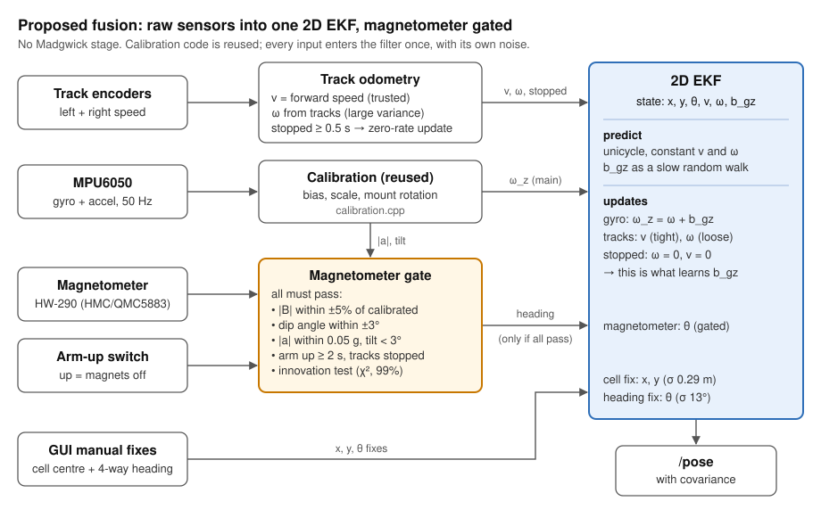

# IMU fusion: Madgwick vs direct Kalman

As of 2026-10-14. Desk research only: the robot was not available, so the evidence
comes from published tests, the MPU6050 datasheet, open-source robot configurations
and the bench measurements already recorded in
[`docs/plans/2026-10-11-imu-madgwick.md`](../plans/2026-10-11-imu-madgwick.md) §10.

## 1. Summary

**Recommendation: drop the Madgwick filter. Feed calibrated gyro Z, track odometry and
an optional, gated magnetometer heading directly into one 2D EKF with a gyro-bias state.**

| Question | Finding | Confidence |
|---|---|---|
| Is Kalman more accurate than Madgwick for orientation? | No. Tuned, they are statistically indistinguishable; tuning matters more than the algorithm (§3) | High: large controlled study |
| Do comparable robots skip the AHRS filter? | Yes. Clearpath's current ROS 2 stack fuses only IMU yaw rate and forward acceleration; ArduPilot Rover runs raw gyro inside its EKF (§4) | High: shipped configurations |
| Where should heading come from on a tracked robot? | The gyro. Track encoders give good speed but poor yaw in turns (§5) | High: tracked-vehicle experiments |
| Should the magnetometer be fused? | Only behind a gate. Ungated, Madgwick and EKF alike drift > 20° within 10 s of a sustained disturbance (§6) | High for the gating claim; the size of this robot's disturbances is unmeasured |
| Is a 2D filter enough at < 10° brief tilt? | Yes. At most 1.5% yaw-rate error while tilted and turning, below the gyro's own ±3% scale tolerance (§7) | High: calculation from datasheet values |
| What keeps heading from drifting? | A zero-rate update whenever the tracks are stopped estimates the gyro bias online (§8) | Medium-high: standard practice; not yet tested on this robot |

The main reason to change is structural, not accuracy. Madgwick's 6-axis yaw is the
same gyro integration the Kalman filter would do itself. Putting it in front of the
Kalman filter hides the gyro bias from the filter, feeds it an invented orientation
covariance with correlated errors, and gives no way to reject a bad magnetometer reading.

## 2. The robot and its constraints

| Constraint | Value | Why it matters |
|---|---|---|
| IMU | HW-290 (GY-87 class): MPU6050 accel/gyro + 3-axis magnetometer + BMP180 | The magnetometer is the only possible absolute heading source |
| Locomotion | Tracked, skid-steer | Tracks slip sideways in every turn, so encoder yaw is unreliable |
| Terrain | Flat field; tilt rarely reaches 10°, and only briefly | Decides 2D vs 3D |
| On-board magnetic sources | Electromagnet arm, drive motors, metal detector coil | Corrupt the magnetometer |
| Targets | Metal objects in the ground | The magnetometer is most disturbed exactly when the robot is working |
| Other inputs | Track encoders; manual position fixes from any labelled edge cell, reported as the cell centre (worst case 0.5 m per axis) | Encoders give speed; frequent fixes bound long-term drift (§9) |
| Magnet and motor control | On a separate controller. The Pi sees no magnet state or motor current, only an arm-up contact switch (arm up means magnets off) and the encoders | The magnetometer gate has to work from proxies (§6.4) |
| Compute | Mini PC, Intel Core i5 7th gen, ROS + camera stream only | Filter cost is irrelevant |
| Measured module (bench, plan §10) | Gyro noise σ ≈ 0.08–0.10 °/s per sample at 50 Hz; bias ≈ (2.56, 1.50, −0.14) °/s, steady over minutes | Sets the starting noise values in §9 |

An uncorrected Z bias of −0.14 °/s is 8.4°/min of heading drift. Bias handling matters
more than the choice of filter.

## 3. Madgwick vs Kalman: what controlled comparisons show

| Study | Setup | Result |
|---|---|---|
| [Caruso et al. 2021](https://pmc.ncbi.nlm.nih.gov/articles/PMC8038545/), *Sensors* | 10 filters (5 complementary incl. Madgwick and Mahony; 5 Kalman), 3 commercial IMUs, 3 rotation speeds, optical reference | Optimally tuned: **no statistically significant difference** among the 10; errors 3.8–7.1°. With default parameters, errors were comparable to an untuned filter, so each filter must be tuned for the scenario |
| [Madgwick et al. 2011](https://pure.ul.ie/en/publications/estimation-of-imu-and-marg-orientation-using-a-gradient-descent-a/), IEEE ICORR | Madgwick vs the Kalman filter in a commercial Xsens unit, optical reference | Accuracy "matching" the Kalman filter: < 0.8° static, < 1.7° dynamic RMS |
| [Ludwig & Burnham 2018](https://web.cs.ndsu.nodak.edu/~siludwig/Publish/papers/ICUAS2018.pdf), ICUAS | Madgwick, Mahony, EKF on quadcopter data | Mahony best: 11° vs Madgwick 13° vs EKF 13.3° RMS (as tabulated by Caruso) |
| [Fan et al. 2018](https://pmc.ncbi.nlm.nih.gov/articles/PMC5795611/), *Sensors* | Madgwick (GDA), EKF, dual linear KF, improved complementary filter, standardised disturbance tests | Undisturbed: EKF and Madgwick performed similarly. Disturbed: all degraded (see §6) |

What carries over to this robot:

- **These are attitude tests, not localization.** All of them score 3D orientation of a
  handheld, worn or flying IMU. None fuses odometry, which is what the minesweeper needs.
- **"Optimal conditions" means no magnetic disturbance.** Caruso's own title says so.
  This robot is the opposite case.
- **Compute cost is irrelevant.** Madgwick needs about 109 operations per update without
  a magnetometer ([Madgwick 2010 report](https://courses.cs.washington.edu/courses/cse466/14au/labs/l4/madgwick_internal_report.pdf)).
  A 6-state EKF is a few 6×6 matrix products per update. At 50 Hz both take
  microseconds on an i5.

So accuracy does not decide the choice. What decides it is what each filter can do
with this robot's sensors.

## 4. Working examples: skid-steer robots that feed the gyro straight into a Kalman filter

| Robot / stack | Drive | IMU inputs fused into the EKF | Uses AHRS yaw? |
|---|---|---|---|
| [Clearpath ROS 2, `clearpath_common` (jazzy)](https://github.com/clearpathrobotics/clearpath_common/blob/jazzy/clearpath_generator_common/clearpath_generator_common/param/platform.py), default EKF for their platforms | Skid-steer (Husky, Jackal, Warthog) and differential | **Yaw rate + forward acceleration only**, `two_d_mode: true` ([config](https://github.com/clearpathrobotics/clearpath_common/blob/jazzy/clearpath_control/config/generic/localization.yaml)) | No orientation fused at all |
| [Jackal, ROS 1 noetic](https://github.com/jackal/jackal/blob/noetic-devel/jackal_control/config/robot_localization.yaml) | 4-wheel skid-steer | Roll, pitch, all three rates; **yaw orientation off** | Runs [`imu_filter_madgwick`](https://github.com/jackal/jackal_robot/blob/noetic-devel/jackal_base/launch/base.launch), but its yaw never reaches the EKF |
| [Husky, ROS 1 noetic](https://github.com/husky/husky/blob/noetic-devel/husky_control/config/localization.yaml) | 4-wheel skid-steer | Roll/pitch/yaw + rates, with `imu0_differential: true` | Orientation is differenced, so it enters as a rate, not an absolute heading |
| [ArduPilot Rover, EKF3](https://ardupilot.org/rover/docs/wheel-encoder.html) | Any, incl. skid-steer | Raw gyro and accel inside one EKF; wheel encoders as velocity (`EK3_SRC1_VELXY = 7`) | No separate AHRS. Gyro biases and compass offsets are states; compass readings past `EKF_MAG_GATE` are rejected ([EKF docs](https://ardupilot.org/dev/docs/extended-kalman-filter.html)). [Compass-less operation](https://ardupilot.org/copter/docs/common-compassless.html) is supported for rovers |

What these establish:

- **The standard IMU input for skid-steer ground robots is yaw *rate*.** None of these
  configurations treats a 6-axis filter's yaw as an absolute heading.
- **The pattern is proven on robots in the minesweeper's class:** small skid-steer
  platforms, often outdoors on rough ground.
- **`robot_localization` has no gyro-bias state.** Its 15-element state vector stops at
  linear acceleration ([`filter_common.hpp`](https://github.com/cra-ros-pkg/robot_localization/blob/ros2/include/robot_localization/filter_common.hpp)),
  so Clearpath relies on a well-calibrated IMU. ArduPilot estimates the bias, and so
  should the custom filter here (§8).

I found no published head-to-head test of "Madgwick yaw into an EKF" against "raw gyro
into an EKF" on the same skid-steer robot. The evidence here is what tested platforms
ship, not a controlled comparison.

## 5. Tracks slip in turns: heading has to come from the gyro

- **[Endo, Okada, Nagatani & Yoshida 2007](https://k-nagatani.org/pdf/2007-IROS-Endo-online.pdf), IROS.**
  A tracked vehicle drove lines and 30 cm radius turns under motion capture.
  - Encoder-only odometry produced large orientation errors whenever the vehicle
    turned, because it ignores slip.
  - "Odometry with a gyro" kept the orientation error small. It took translation from
    the tracks and rotation from the gyro (Ω = Ω_gyro).
  - The authors note that the gyro bounds the orientation error, which matters most
    for odometry. Their slip-compensated method then improved position, not heading.
- **[Pentzer, Brennan & Reichard 2014](https://pure.psu.edu/en/publications/model-based-prediction-of-skid-steer-robot-kinematics-using-onlin/), *J. Field Robotics*.**
  An EKF learned each track's instantaneous centre of rotation (ICR) online. With the
  learned values, tracked-vehicle odometry had a mean position error of −0.42 m over
  40.5 m (about 1%).
- **Borenstein & Feng 1996, "Gyrodometry", ICRA (DOI 10.1109/ROBOT.1996.503813).**
  The original method: trust odometry for heading except when it disagrees sharply with
  the gyro, which flags slip or a bump.

Consequences for the filter:

1. Track encoders measure **forward speed v**, with modest noise that is inflated while turning.
2. Encoder yaw rate gets a **large variance**, or is left out. The skid in a turn on grass
   or soil is large and unpredictable.
3. **Gyro Z is the main yaw-rate measurement.** Its errors are bias and scale, which the
   filter estimates or calibration removes.
4. An ICR or effective-track-width parameter can be added later if position drift over a
   field run is too large.

## 6. The magnetometer: fuse it only behind a gate

### 6.1 Ungated fusion fails, whichever filter does it

The key result comes from [Fan et al. 2018](https://pmc.ncbi.nlm.nih.gov/articles/PMC5795611/).
They ran four filters through the same standardised magnetic-disturbance tests, with
optical reference. The filters were Madgwick (GDA, β = 0.1), a quaternion EKF with gyro
bias, a dual linear KF and an improved complementary filter:

- **Sustained disturbance:** Madgwick, the EKF and the dual KF all swung to the wrong
  heading **within 10 s**. Peak yaw errors were 21.44°, 21.66° and 21.45°.
- **Even a short disturbance:** peak yaw errors were 6.99° for Madgwick and 11.81° for
  the EKF.
- **Gyro only, magnetometer ignored:** this variant (IECF₆) had the best yaw in the
  10 s, 30 s and 60 s disturbance tests, once its start heading was aligned.
- **Their conclusion:** a good adaptive filter should match gyro-only performance during
  disturbances, while still giving absolute yaw when the field is clean.

So an ungated EKF is no better than Madgwick. **The gate is what makes the difference,
and only the Kalman structure gives it a natural place:** a per-reading measurement
variance, and an innovation test against the gyro-predicted heading.

### 6.2 Tested gating methods

| Method | Evidence | Strength | Weakness |
|---|---|---|---|
| **Threshold on field strength and dip angle.** Reject, or set R → ∞, when \|B\| or dip leaves its calibrated value | Reviewed in [Fan 2018](https://pmc.ncbi.nlm.nih.gov/articles/PMC5795611/) and the [Ligorio & Sabatini 2018 survey](https://pmc.ncbi.nlm.nih.gov/articles/PMC6189838/). [Yadav & Bleakley 2014](https://pmc.ncbi.nlm.nih.gov/articles/PMC4279468/) showed that **dip angle plus strength** detects far more distortion than strength alone; they reached < 2° static and < 5° dynamic peak-to-peak with metal nearby | Simple and cheap; catches short disturbances well (Ligorio: threshold methods suited the short-disturbance task) | Thresholds are hard to set; behaviour is unstable near the threshold (fix: two thresholds, i.e. hysteresis). A **slowly approached** disturbance can slip under the threshold |
| **Innovation (χ²) gate.** Reject when the heading residual against the gyro prediction exceeds k·σ | Standard in ArduPilot (`EKF_MAG_GATE`, in standard deviations) | Catches disturbances that leave \|B\| and dip unchanged | Can lock out a correct magnetometer if heading has drifted far; needs a recovery rule |
| **Model the disturbance as a state.** Estimate the disturbance field in the filter | [Roetenberg et al. 2005](https://research.utwente.nl/en/publications/compensation-of-magnetic-disturbances-improves-inertial-and-magne/): 1.4° static and 2.6° dynamic RMS near ferromagnetic material, significantly better than no compensation (p < 0.01). [Roetenberg et al. 2007](https://research.utwente.nl/en/publications/estimating-body-segment-orientation-by-applying-inertial-and-magn/): near a large metal object, **up to 50° instantaneous error uncompensated**, 3.6° RMS with the model | Best compromise in the Ligorio survey; no threshold to tune | More states and tuning; designed for slowly varying fields, not a switched electromagnet |
| **Context gating.** Skip the magnetometer when the robot is likely disturbing it | Not in the papers above; follows from ArduPilot's note that motor interference is linear in current ([compass setup](https://ardupilot.org/copter/docs/common-compass-setup-advanced.html)) | Removes the robot's largest known sources before any threshold has to catch them | Here only **proxies** are available: the magnets and motors run on a separate controller, so the filter sees an arm-up switch and the encoders, not magnet state or motor current (§6.4) |

### 6.3 How large the disturbances are on this robot

The Earth's field is 25–65 µT, and heading uses only its horizontal part. A few µT of
on-board field therefore moves heading by degrees.

| Source | Size | Basis |
|---|---|---|
| Motor and battery current | B = 2×10⁻⁷ · I / r: 5 A at 5 cm gives 20 µT, comparable to the Earth's horizontal field | Calculation (straight wire). ArduPilot calls interference linear with current and treats > 60% as needing relocation ([compass setup](https://ardupilot.org/copter/docs/common-compass-setup-advanced.html)) |
| Engine, motors, steel chassis | About 90° heading error on a 50 kg rover with an engine about 30 cm away | [ArduPilot forum](https://discuss.ardupilot.org/t/compass-problem-on-large-rover/57700). The fixes there were a mast, a better sensor, or replacing the compass with GNSS heading |
| Electromagnet arm | Unknown. Strong near the coil, falling as 1/r³; nearby steel may stay magnetised after switch-off | Must be measured |
| Metal detector coil | Unknown. Alternating field; an averaging magnetometer may see it as noise or an offset | Must be measured |
| Buried metal (the targets) | Mostly a dipole anomaly ([USGS](https://pubs.usgs.gov/publication/70028193)), rising as 1/r³ as the robot closes in. The approach is slow, which is the case threshold gates miss | Derived, not measured |

### 6.4 Proposed gate for this robot

Accept a magnetometer heading only when **all** of these hold. Use hysteresis on the
thresholds, and require N consecutive passes (e.g. 10 samples = 0.2 s) before
re-admitting the magnetometer after a rejection.

1. Context, from proxies (the magnets and motors run on a separate controller, so neither
   magnet state nor motor current reaches the filter):
   - **Arm-up switch closed for ≥ 2 s → magnets assumed off.** The hold-off covers coil
     decay and the case where the switch closes before the other controller has released
     the magnets.
   - **Both track encoders at zero for ≥ 0.5 s → motors assumed idle.** This is the same
     "stopped" signal the zero-rate update uses (§8).
   - **Consequence:** the magnetometer is used only at stops with the arm up. Each such
     stop then gives both a gyro-bias update and a heading fix. Moments with the arm down,
     which are the moments near a target, are always rejected.
2. Field strength: | \|B\| − B₀ | < 5% of B₀ (B₀ from on-robot calibration with the arm up).
3. Dip angle: | dip − dip₀ | < 3°. Dip is computed from the magnetometer and accelerometer.
4. Tilt and acceleration: | \|a\| − g | < 0.05 g and accelerometer tilt < 3°. This keeps the
   heading computation valid without tilt compensation (§7).
5. Innovation: NIS = ν² / S < 6.63 (χ² with 1 degree of freedom, 99%).
6. Recovery rule: if the magnetometer has been rejected for longer than T (e.g. 60 s)
   while checks 1–4 pass, the innovation gate may be blocking a correct reading after
   gyro drift. Re-admit it with inflated R instead of blocking forever.

All thresholds are starting values to tune against the bench logs in §10.

**Because check 1 uses proxies, checks 2 and 3 are the safety net, not a refinement.** Each
proxy has a case where it is wrong, and the field checks are what catch it:

| Proxy says | But actually | Caught by | Open question for the team |
|---|---|---|---|
| Arm up, so magnets off | Magnet energised with the arm up (carrying a captured object upright, or a controller fault) | Field strength: a live magnet nearby is far outside ±5% | Can the arm ever be up with the magnet on? If so, the switch alone is not a safe proxy |
| Arm up, so magnets off | Steel near the arm stays slightly magnetised after release | Partly. A small remanent offset may pass the ±5% strength check but still shift heading by a few degrees | Measure on the bench: field at the IMU before and after a magnet cycle, arm up |
| Encoders zero, so motors idle | Driver holds current at standstill (brake or hold mode), or the tracks are stalled against an obstacle | Field strength and dip, if the current is large enough to matter | Does the motor driver coast, brake, or hold current when stopped? |
| Encoders zero, so robot stopped | Slow creep below one encoder count per window | Gyro and accelerometer variance check (§8) | — |

The metal detector is not a proxy problem: `metal_detector_raw` already reaches the Pi in
the telemetry packet. Whether its coil disturbs the magnetometer still has to be measured.

### 6.5 HW-290 specifics

- **The chip may be a clone.** The GY-87 carries an HMC5883L; the HW-290 often has a QMC5883
  instead ([AAU notes](https://satlab.aau.dk/stem/jensd/doc/aau-cansat/gy80gy87gy88gy91)).
  The two have different registers and addresses (0x1E HMC, 0x0D QMC; 0x2C on the
  QMC5883P), so run an I2C scan first.
- **It sits behind the MPU6050**, on the auxiliary I2C bus. Set `INT_PIN_CFG` (0x37)
  bit 1 (bypass) and clear `I2C_MST_EN` before the magnetometer appears on the bus.
- **`TelemetryPacket_t` has no magnetometer fields and no arm-switch bit.** Add both in one
  protocol change: three `int16_t` magnetometer axes plus a `uint8_t` status byte with
  the arm-up switch in bit 0. That takes the packet from 24 to 31 bytes. The change
  touches the STM32 firmware, the ESP32 test rig, `wire.py` and the reader's length check.
  The switch must be wired to the board that sends telemetry, not to the new
  magnet/motor controller.

## 7. Tilt: a 2D filter is enough below 10°

**Gyro.** The body Z gyro measures yaw rate scaled by tilt, plus a cross term from pitching
while rolled:

    ω_z = ψ̇ · cos θ · cos φ − θ̇ · sin φ

| Tilt held through a 90° turn | Yaw-rate error 1 − cos(tilt) | Heading error after the turn |
|---|---|---|
| 2° | 0.06% | 0.05° |
| 5° | 0.38% | 0.34° |
| 10° | 1.52% | 1.4° |

The real error is smaller than this table:

- **The robot is rarely tilted and turning at the same time.** Driving straight over a
  bump has ψ̇ ≈ 0.
- **The cross term cancels over a bump.** θ̇ rises and falls as the robot passes over, so
  its integral is near zero.

For comparison, the [MPU6050 datasheet](https://alliance.seas.upenn.edu/~medesign/wiki/uploads/Guides/MPU6050_datasheet.pdf)
allows **±3% gyro sensitivity tolerance and ±2% cross-axis sensitivity**. The plan's yaw-scale
calibration (spin a known angle) is therefore worth more than modelling tilt. Fixed
mounting tilt is already removed by `R_mount`.

**Track odometry.** On a 10° slope the tracks overstate horizontal distance by 1.5%, only
for the length of the slope. Track slip is larger.

**Magnetometer.** Here tilt matters. Worst case, an uncompensated reading tilted by θ is
off by roughly δψ ≈ atan(tan θ · tan I), where I is the local dip angle. At I = 45°, a
10° tilt gives about 10°; at I = 60°, about 17°. Gate check 4 in §6.4 rejects those readings.
The robot spends far more time level than tilted, so this costs few readings.

**3D would be needed only for** sustained slopes, an arm or camera that needs roll and
pitch, or using the magnetometer while moving over rough ground. None applies here.

## 8. Gyro bias: estimate it every time the tracks stop

- **The bias is large and moves.**
  - The datasheet allows ±20 °/s initial zero-rate offset and ±20 °/s more over
    temperature.
  - This module measured −0.14 °/s on Z, i.e. 8.4°/min if left uncorrected.
  - MPU6050 bias also shows [temperature hysteresis](https://adm.invensense.tdk.com/mpu-6050-thermal-chamber-results-unexplained-bias-behaviour).
- **A zero-rate update needs no special motion.** When the robot is stopped, true yaw rate
  is 0, so the gyro reading *is* the bias. Feeding ω = 0 as a tight measurement makes the
  bias state b_gz observable. This is the mechanism behind the online bias estimation in
  ArduPilot's EKF and in [Fan 2018's EKF](https://pmc.ncbi.nlm.nih.gov/articles/PMC5795611/)
  (quaternion + gyro bias state).
- **Detecting "stopped" is easier on this robot than on a handheld IMU.**
  - Track encoders read zero and the commanded velocity is zero for ≥ 0.5 s.
  - To catch slow creep, also require gyro and accelerometer variance below a threshold.
  - Encoder-only stop detection can admit slow motion, which would corrupt the bias.
- **Startup.** Initialise b_gz from the existing 3 s standstill average (`GyroBiasEstimator`),
  with a variance that reflects the window length.

This replaces the existing EMA-based online bias update with the same idea inside the
filter. The filter then also knows how uncertain the bias is.

## 9. Proposed filter

**State:** x = [x, y, θ, v, ω, b_gz]. All starting values below are to be tuned against bags.

**Predict** (dt from `header.stamp`, clamped as in the current node):

    x  += v · cos θ · dt
    y  += v · sin θ · dt
    θ  += ω · dt
    v, ω    : random walk (process noise from expected accelerations)
    b_gz    : random walk, very small

| Process noise | Starting value | Reasoning |
|---|---|---|
| σ_v̇ (longitudinal acceleration) | 0.5 m/s² | Tracked robot, gentle starts and stops |
| σ_ω̇ (angular acceleration) | 1.0 rad/s² | Skid-steer turns start abruptly |
| σ_b (bias random walk) | 1×10⁻⁴ rad/s per √s | Refine from the Allan variance run in plan §6.2 |

**Measurements:**

| Measurement | Model | Starting R (σ) | Notes |
|---|---|---|---|
| Gyro Z (calibrated) | z = ω + b_gz | 0.003 rad/s (0.17 °/s) | Bench σ is 0.0014–0.0017 rad/s; doubled for track vibration |
| Track speed | z = v | 0.05 m/s, inflated by k·\|ω\| in turns | Longitudinal slip |
| Track yaw rate | z = ω | 0.3 rad/s, or omit | Skid in turns (§5) |
| Stopped | z = [v, ω] = 0 | 0.001 m/s, 0.0005 rad/s | Makes b_gz observable (§8) |
| Magnetometer heading | z = θ + offset | 5° | Only through the gate in §6.4 |
| Edge-cell fix (GUI) | z = [x, y] = centre of the labelled cell | 0.29 m per axis | A measurement, not a hard reset (see below) |
| Heading fix (GUI) | z = θ, one of 0°/90°/180°/270° | 13° (≈ 3° if "aligned") | A measurement, not a hard reset (see below) |

**Manual position fixes from edge cells.** The field's edges carry cell labels, so the
operator can fix the position from any edge cell. The GUI reports the centre of that cell.

- **Error.** Worst case is 0.5 m per axis (0.71 m to a cell corner). If the robot can be
  anywhere in the cell, σ = 1/√12 ≈ 0.29 m per axis; start there and lower it once logs
  show how close to the centre the robot usually sits.
- **Fuse it as a Kalman measurement, not a hard reset.** The architecture doc's "set the
  pose and zero the covariance" would make the filter certain of a position that can be
  0.5 m off. It would then under-weight later measurements, and a bad reset would stick.
  As a measurement, the filter weighs the fix against its own uncertainty. A fix shortly
  after the previous one changes little; one after a long drive changes a lot.
- **It corrects heading too.** While driving, heading error turns into sideways position
  error, so the EKF correlates the two. Successive fixes along a run therefore correct θ
  with no extra code. Fixes 5 m apart give roughly a 5° heading constraint on their own.
- **Catch wrong-cell clicks.** A neighbouring-cell mistake is 1 m off, about 3.4σ of the
  reset alone. If the Mahalanobis distance of a fix exceeds the 99% χ² limit for
  2 degrees of freedom (9.21), ask the operator to confirm instead of applying it silently.
**Manual heading fixes to one of four grid directions.** The GUI sets the heading to the
nearest grid direction (0°, 90°, 180° or 270°). The operator uses it only when the
robot is roughly aligned with the grid, which keeps the worst case at 22.5°. A snap from
any heading would allow up to 45° (σ ≈ 26°).

- **Error.** If the true heading can be anywhere within ±22.5°, σ = 45°/√12 ≈ 13°. Fuse
  it as a θ measurement with σ = 13°, never as a hard reset. A hard reset could inject up
  to 22.5° of error, which becomes 3.8 m of sideways error over 10 m of driving.
- **What it is good for:**
  - **Startup:** the filter starts with no idea of heading relative to the grid. The
    first fix gives it one.
  - **Recovery:** after a long run with no fixes, or after something went wrong.
- **What it is not good for:** refining a heading the filter already knows to a few
  degrees. With σ = 13° against a filter σ of 3°, a fix moves heading by only about 5%
  of the difference, which is the correct behaviour. Fine heading comes from the gyro, the
  gated magnetometer, and successive cell fixes while driving (above).
- **Wrong-direction picks.** Picking the wrong direction is 90° off, about 7σ. Ask for
  confirmation when the wrapped innovation exceeds 3σ of the combined uncertainty
  (√(13² + σ_θ²) degrees). Compute the innovation with angle wrap to ±180°.
- **Better when aligned.** If the operator snaps only when the robot is visibly squared to
  a grid line (tracks parallel to the edge labels), the real error is a few degrees.
  Offer an "aligned" option in the GUI with σ ≈ 3°, and keep the 13° default for a
  rough snap.

**What is reused from the current package:**

| Kept | Retired |
|---|---|
| `calibration.cpp` (bias, scale, `R_mount`) | `madgwick.cpp` and `test_madgwick.cpp` |
| `GyroBiasEstimator` startup window (initial b_gz) | The Madgwick update in `madgwick_node.cpp` |
| `imu_calibrate.py` (gyro, spin, allan modes) | `/imu/rpy` debug output (replaced by θ from `/pose`) |
| The reader's timestamp de-jitter, now more important because the predict step depends on dt | |

**Cheaper alternative:** strip Madgwick out of the existing node, keep its calibration and
bias correction, and feed `robot_localization` the way Clearpath does (yaw rate + v). This
needs no custom filter code. However, it has no bias state, and its only magnetometer
protection is a Mahalanobis rejection threshold, with no context gate. It is fine as a
first step without the magnetometer.

## 10. Risks and validation plan

### Risks

| Risk | Effect | Mitigation |
|---|---|---|
| Gyro Z scale error (±3% datasheet) | Degrees of error per turn | Spin calibration (plan §6.2), 5 turns ±2° acceptance |
| Track vibration aliasing into gyro Z | Larger yaw noise, bias offset | Keep DLPF (CONFIG = 3); inflate R; check spectrum on first drive |
| Bias drift during warm-up | Drift between stops | Zero-rate updates at every stop; log bias against temperature |
| Slowly approached metal fools the threshold gate | Wrong heading near a target | Innovation gate + context gate; magnetometer off by default |
| Context gate relies on proxies (arm switch, encoders), not magnet state or motor current | A live magnet or held motor current is let through | Field strength and dip checks; the open questions in §6.4 |
| Long runs without stopping | Bias not re-estimated | Plan a brief stop at each grid lane end, combined with an edge-cell fix |
| Timestamp jitter | Wrong dt in predict | Existing de-jitter; same requirement on the production bridge |

### What can be done now, without the robot

1. Replay the existing bags through a prototype EKF (no magnetometer). Its θ must match
   the Madgwick yaw within noise; this checks signs, frames and dt handling.
2. Identify the magnetometer chip (I2C scan after enabling bypass) and log raw field data on
   the ESP32 rig.
3. Bench disturbance test: log \|B\|, dip and computed heading with a steel object, a
   permanent magnet and a current-carrying wire at 50, 20, 10 and 5 cm. Approach slowly as
   well as quickly. Use the logs to set the §6.4 thresholds, then replay them through the
   gate to confirm it rejects every disturbed sample.
4. Unit tests (gtest, like the existing ones): bias convergence under a constant offset with
   zero-rate updates; gate rejection on synthetic disturbances; correct innovation for
   angle wrap-around.

### What to do when the robot is available

| Test | Pass criterion |
|---|---|
| Stationary, toggle motors / electromagnet / detector one at a time | Record heading shift for each. Any shift > 3° from a source the proxies cannot see (e.g. the detector) needs its own gate |
| Stationary, arm up, cycle the magnet on and off several times | Field at the IMU returns to within the gate's tolerance after the 2 s hold-off (checks remanence) |
| Stationary, tracks stopped, motor driver idle vs holding | No field change while stopped (confirms the encoder proxy) |
| Spin in place 5 turns (plan §5.4) | Integrated yaw within ±2° of 1800° |
| Drive a closed loop back to a marked start, 3 times | Heading error < 3° and position error < 2% of path length, magnetometer off |
| Same loop, magnetometer on with the gate | No worse than magnetometer off; better on long runs if the field is clean |
| Drive past a steel target with the magnet cycling | Gate rejects all disturbed samples; heading error stays within the gyro-only error |
| 10 min of stops and starts | b_gz converges and the bias-corrected mean stays within ±0.1 °/s |

## Sources

Opened and read for this report:

- Caruso et al. 2021, *Analysis of the Accuracy of Ten Algorithms for Orientation Estimation…*: https://pmc.ncbi.nlm.nih.gov/articles/PMC8038545/
- Madgwick et al. 2011, *Estimation of IMU and MARG orientation using a gradient descent algorithm* (abstract): https://pure.ul.ie/en/publications/estimation-of-imu-and-marg-orientation-using-a-gradient-descent-a/
- Madgwick 2010 internal report: https://courses.cs.washington.edu/courses/cse466/14au/labs/l4/madgwick_internal_report.pdf
- Fan et al. 2018, *How Magnetic Disturbance Influences the Attitude and Heading…*: https://pmc.ncbi.nlm.nih.gov/articles/PMC5795611/
- Ligorio & Sabatini 2018, *Dealing with Magnetic Disturbances in Human Motion Capture: A Survey*: https://pmc.ncbi.nlm.nih.gov/articles/PMC6189838/
- Yadav & Bleakley 2014, *Accurate Orientation Estimation Using AHRS under Conditions of Magnetic Distortion*: https://pmc.ncbi.nlm.nih.gov/articles/PMC4279468/
- Roetenberg et al. 2005 (abstract): https://research.utwente.nl/en/publications/compensation-of-magnetic-disturbances-improves-inertial-and-magne/
- Roetenberg et al. 2007 (abstract): https://research.utwente.nl/en/publications/estimating-body-segment-orientation-by-applying-inertial-and-magn/
- Endo et al. 2007, *Path Following Control for Tracked Vehicles Based on Slip-Compensating Odometry*: https://k-nagatani.org/pdf/2007-IROS-Endo-online.pdf
- Pentzer, Brennan & Reichard 2014 (abstract): https://pure.psu.edu/en/publications/model-based-prediction-of-skid-steer-robot-kinematics-using-onlin/
- Clearpath `clearpath_common` (jazzy) EKF parameters: https://github.com/clearpathrobotics/clearpath_common
- Jackal EKF config: https://github.com/jackal/jackal/blob/noetic-devel/jackal_control/config/robot_localization.yaml and base launch: https://github.com/jackal/jackal_robot/blob/noetic-devel/jackal_base/launch/base.launch
- Husky EKF config: https://github.com/husky/husky/blob/noetic-devel/husky_control/config/localization.yaml
- robot_localization state definition: https://github.com/cra-ros-pkg/robot_localization/blob/ros2/include/robot_localization/filter_common.hpp
- ArduPilot: wheel encoders https://ardupilot.org/rover/docs/wheel-encoder.html · EKF https://ardupilot.org/dev/docs/extended-kalman-filter.html · compass-less https://ardupilot.org/copter/docs/common-compassless.html · compass setup https://ardupilot.org/copter/docs/common-compass-setup-advanced.html · large-rover compass thread https://discuss.ardupilot.org/t/compass-problem-on-large-rover/57700
- MPU6050 product specification rev 3.1: https://alliance.seas.upenn.edu/~medesign/wiki/uploads/Guides/MPU6050_datasheet.pdf
- AAU CanSat IMU notes (GY-87 / HW-290): https://satlab.aau.dk/stem/jensd/doc/aau-cansat/gy80gy87gy88gy91

Cited from abstracts or search listings only (not opened in full): Ludwig & Burnham 2018
(ICUAS), Ludwig et al. 2018 (SPIE), Borenstein & Feng 1996 (Gyrodometry), USGS UXO dipole
modelling, the MPU6050 thermal-bias forum thread.
